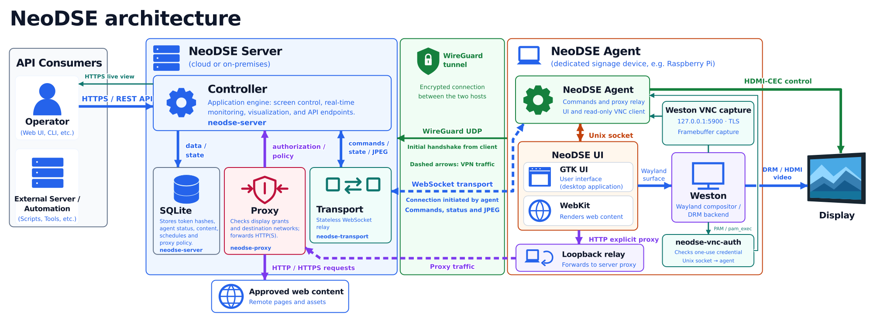

# NeoDSE - Digital Signage Engine

**Self-hosted digital signage, display management and alerts.**

NeoDSE manages dedicated Linux displays from a central dashboard or API.
Show web pages you already maintain, rotate dashboards across screens, and send
banners or sounds from your monitoring tools. It runs on your infrastructure,
including isolated networks with locally hosted content, without external cloud
services.

[Get started](#get-started) · [Documentation](#documentation) · [Releases](https://github.com/RealisLux/NeoDSE/releases)

*The animation illustrates shared display management in spaces such as offices,
reception areas and other venues. Sound is shown visually; warning lights need a
compatible serial controller.* See the [example request flow](neodse-overview.svg).

## Why choose NeoDSE?

NeoDSE brings web dashboards, display control and incident alerts together
on your own network.

- **Use existing dashboards.** Display web pages and internal tools without
  rebuilding their content in a signage editor.
- **Manage screens together.** Coordinate playlists, check live output and
  control display power from one place.
- **Make incidents visible and audible.** Connect monitoring alerts to banners,
  notification sounds and supported warning lights through the API.
- **Keep control of the platform.** Run it without external cloud services.

NeoDSE is a good fit for teams that manage Linux displays and their network.
Your team handles deployment and maintenance; displayed pages must work
without signing in. See the [limitations](#limitations) before deploying.

## Features

- **Existing web content.** Display up to six HTTP(S) pages per playlist, with
  rotation intervals and synchronized playback. Saved content returns when an
  agent reconnects.
- **Fleet management.** Manage one display or broadcast to a fleet, check device
  status and track command results through the dashboard or API.
- **Live viewing.** See a display's actual output in a read-only dashboard view.
- **Displays and peripherals.** Schedule screen power, control HDMI-CEC and
  audio, show banners, play sounds and operate supported serial devices.
- **Access control.** Authenticate devices and give operators roles and display
  scopes.
- **Proxy isolation.** The browser uses the agent's loopback relay. An
  authenticated proxy checks web destinations against per-display permissions and
  permitted content networks, keeping content access separate from the
  management API. [HTTPS tunnel limits](SECURITY.md#residual-risks) apply.
- **Your infrastructure.** Connect hosts over WireGuard and keep browser state
  temporary.

## Limitations

- **Pages must work without login or SSO.** NeoDSE authenticates operators and
  devices, but does not manage website credentials or restore website sessions
  after renderer restarts.
- **Live viewing is read-only, with one viewer per display.** It cannot send
  keyboard or mouse input to a page.
- **Weston can affect live-view images.** With affected versions (observed with
  14.0.2), scaling or rotation, particularly portrait, can produce cropped or
  incorrectly rotated live views even when the physical display is correct.
  Check the Weston version supplied by your distribution.
- **IPv4 is required** for addresses inside WireGuard and for proxied web
  content. WireGuard itself can connect hosts over IPv4 or IPv6; see the
  [endpoint requirements](docs/DEPLOYMENT.md#controller).
- **Not a safety system.** NeoDSE has not been qualified as a safety-critical
  alarm or protective-control system. An accepted API request does not confirm
  execution: check [command results](docs/OPERATIONS.md#monitoring) and physical
  behavior, and validate connected equipment before relying on it.

## How it works

A controller stores configuration and coordinates content and commands. Each
Linux display runs an agent and a fullscreen web renderer.

| Component | Role |
| --- | --- |
| `neodse-server` | HTTPS API, SQLite storage, desired state and scheduling |
| `neodse-transport` | Stateless WebSocket routing between controller and agents |
| `neodse-proxy` | Authorized HTTP(S) access to approved web destinations |
| `neodse-agent` | Device authentication, content delivery and hardware control |
| `neodse-ui` | Fullscreen GTK/WebKit rendering under Weston |
| Weston and `neodse-vnc-auth` | Local TLS-protected VNC capture and one-use PAM authentication for read-only live viewing |

WireGuard protects host traffic; per-agent keys authenticate application
messages. Browser state stays under `/run/neodse-ui` and content is restored after
reconnection. See [architecture](docs/ARCHITECTURE.md) for the protocol, storage
and [API route map](docs/ARCHITECTURE.md#api-routes).

## Get started

You need a controller, one Linux client per display, and UDP connectivity from
each client to the controller's WireGuard port. The controller can be a physical
server, VM, Raspberry Pi or cloud host. Raspberry Pi 5 is recommended for
clients; check HDMI-CEC support on your hardware.

Install only on clean hosts, as the [installation requirements](docs/DEPLOYMENT.md#install)
describe, and isolate controllers and displays from unrelated systems; see
[network isolation](docs/FIREWALL.md#network-isolation).

| Host | Server package | Client package |
| --- | --- | --- |
| Debian 13 or Ubuntu 26.04 | `amd64`, `arm64` | `amd64`, `arm64` |
| Enterprise Linux 9 or 10 | `amd64` | — |

The [deployment guide](docs/DEPLOYMENT.md) walks through installation:

1. [Download and verify packages](docs/DEPLOYMENT.md#packages) for your exact
   distribution and architecture, or [build locally](docs/DEVELOPMENT.md#build-packages).
2. [Install](docs/DEPLOYMENT.md#install) the server on the controller and the
   client on each display.
3. [Bootstrap](docs/DEPLOYMENT.md#bootstrap) each host, store the database
   passphrase and the administrator token, unlock the controller, configure TLS
   and the firewall, and [authorize content networks](docs/DEPLOYMENT.md#authorize-content-networks).
4. [Provision displays](docs/DEPLOYMENT.md#provision-displays) by exchanging
   enrollment blocks, then [verify enrollment](docs/DEPLOYMENT.md#verify-enrollment).
5. Open `https://127.0.0.1:8443/` on the controller and sign in with a scoped
   service-account token. For remote access, use an
   [SSH tunnel](docs/OPERATIONS.md#api-access) or [restricted LAN access](docs/CONFIGURATION.md#lan-api-access).

Only the WireGuard UDP endpoint may face a wider network: transport and proxy
run inside WireGuard, and the API stays on loopback or a restricted management
LAN. Exposing WireGuard to the Internet adds risk that needs its own protection.
Read the [firewall guide](docs/FIREWALL.md) and [security model](SECURITY.md)
before deployment.

## Documentation

Administrators deploy, configure and maintain NeoDSE. Operators use the dashboard
or API within their assigned roles and display scopes. One person can do both.

| Guide | Covers |
| --- | --- |
| [Deployment](docs/DEPLOYMENT.md) | Hardware, packages, installation and enrollment |
| [Firewall](docs/FIREWALL.md) | Required access, client isolation and firewalld examples |
| [Operations](docs/OPERATIONS.md) | Daily use, monitoring, upgrades and restoration |
| [Configuration](docs/CONFIGURATION.md) | YAML fields, LAN API access, permissions and display settings |
| [Security](SECURITY.md) | Security model, secret rotation, residual risks and vulnerability reporting |
| [Architecture](docs/ARCHITECTURE.md) | Components, protocol, content flow and source layout |
| [Development](docs/DEVELOPMENT.md) | Builds, tests, dependencies and maintenance |
| [Release checklist](docs/RELEASE.md) | Validation, signing and GitHub publication |

The API reference is at `https://127.0.0.1:8443/docs/` after deployment.
Its source is [openapi.yaml](internal/swagger/openapi.yaml).

## License

NeoDSE's original code, documentation and assets use the [MIT License](LICENSE)
and are provided **as is**, without warranty. Third-party components keep their
own terms; [NOTICE](NOTICE) lists where to find them.

## Support

Report bugs, request features and submit pull requests as described in
[CONTRIBUTING.md](CONTRIBUTING.md). Responses, resolution times and merging are
not guaranteed. Report vulnerabilities privately through [SECURITY.md](SECURITY.md).
Security fixes cover only the latest production release.
