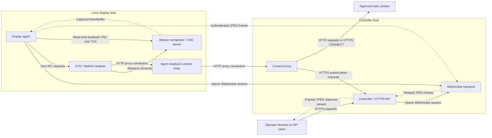
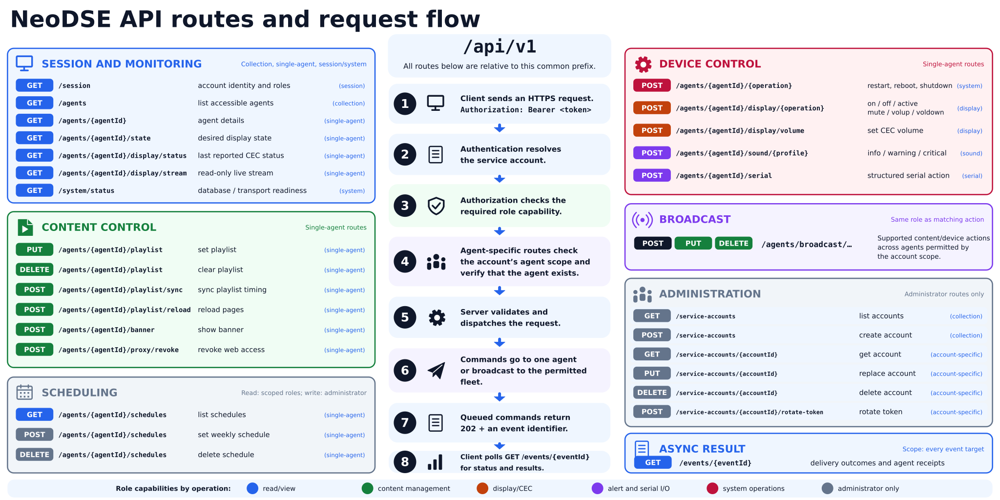

# Architecture

The controller runs the API server, transport and content proxy. Each display
runs an agent and a GTK/WebKit renderer under Weston. The controller stores the
desired state; agents apply it and execute commands. The
[README](../README.md#how-it-works) gives a component overview.

## Connections and live-view flow

Solid arrows show who opens a connection or sends a request; replies can travel
in the other direction. Dashed arrows trace live-view images over those connections.

The controller and agents each open a WebSocket connection to the transport:
the controller at `/v1/controller`, signed with `server.transport_psk`, and
each agent at `/v1/agents/{agentId}`, which the controller authenticates end to
end. Commands travel toward agents; status, receipts and live-view frames return
to the controller. The transport never opens connections to displays.
Non-loopback plaintext links use WireGuard.

The agent sends content and UI commands through the renderer's Unix socket.
WebKit reaches web content through the agent's loopback relay and the controller's
proxy. The proxy asks the controller for authorization before opening an upstream
connection, through `/internal/v1/proxy/authorize` on the API listener, which
requires the token derived from `proxy.internal_psk`. Responses follow the same
path, including secure WebSocket traffic inside HTTPS CONNECT tunnels.

For live viewing, the operator opens an HTTPS stream. The agent reads Weston's
loopback VNC output, encodes it as JPEG frames and sends them through the
transport and controller. It sends VNC protocol requests, but no keyboard or mouse
input.

## State and delivery

SQLite stores agents, credentials, accounts, desired content, schedules, events,
receipts and proxy policy. The database, its WAL and its journal are encrypted
with AES-256-XTS. The controller starts locked and opens the database only after
root supplies the passphrase that unseals its key; see
[unlocking the controller](OPERATIONS.md#unlocking-the-controller). The transport
routes bounded frames without agent pre-shared keys (PSKs) or durable state.
Agents manage sessions, hardware and the UI relay. The renderer keeps temporary
GTK/WebKit state under private `/run/neodse-ui`. Weston and the renderer share
the PAM-managed `/run/user/<uid>` runtime directory and user bus; `/run/neodse`
holds the IPC sockets and generated Weston configuration. Only `neodse-ui`
can change entries in that directory; the agent's IPC group has traversal and
socket access.

The controller commits desired content before sending it and reconciles it after
reconnect. Revision, playlist and proxy grants are read in one transaction with
the reconciliation event that identifies that snapshot. If a queued publication
has been superseded before dispatch, the latest state gets a new reconciliation
event; the original publication keeps its requested revision and outcome.
Agents tie applied revisions to the renderer socket: a missing or replaced socket
triggers reconciliation on the next heartbeat. A failed application is retried
after its failure receipt drains.

When reconciliation finds the playlist already applied, the agent reloads its
pages after a random delay of up to 15 seconds, so a controller restart does not
reload every display at once. Newer content cancels a pending reload and waits
for any reload already in progress before replacing the playlist. Applying a
revision resolves earlier unresolved publications for that display: older
revisions become `expired` and the same revision becomes `accepted`.

A timing-only update requires the previous revision of the same generation to be
applied on the same renderer; otherwise the agent restores the full playlist.
Newer commits clear obsolete timing-only hints.

Every second, the renderer checks playback against wall-clock time. A clock
correction selects the current playlist position, or restores the waiting screen
if the start time is now in the future, without unloading documents. Keep
controller and display clocks [synchronized](DEPLOYMENT.md#time-synchronization).

Banners, CEC, audio, serial and host actions are transient. The controller claims a
`queued` delivery as `uncertain` before sending it; ambiguous attempts are not
retried automatically. See [operations](OPERATIONS.md#monitoring) for delivery outcomes.

Receipt history retains the first diagnostic for each lifecycle status, at most
six receipts per event target. Repeated authenticated receipts advance the
session sequence without repeating status updates or restart reconciliation.

## Serial peripheral protocol

Serial actions use the commands below, terminated by CRLF. A compatible peripheral
returns optional data lines followed by `OK`, or `ERROR[:reason]`. Each agent runs
one exchange at a time, within the configured response timeout.

| API action | Wire command |
| --- | --- |
| Beacon on / off | `AT+BEACON=ON` / `AT+BEACON=OFF` |
| Beacon blink | `AT+BEACON=BLINK,<period_ms>` |
| Buzzer on / off | `AT+BUZZER=ON` / `AT+BUZZER=OFF` |
| Relay on / off | `AT+RELAY=<relay_id>,ON` / `AT+RELAY=<relay_id>,OFF` |
| Device information | `AT+INFO?` |
| Device status | `AT+STATUS?` |

Blink periods are 100–60000 ms and relay IDs are 1–32. Devices with a different
command protocol require an adapter; NeoDSE does not send raw operator-defined
serial commands. See [configuration](CONFIGURATION.md#sound-and-peripherals).

## Enrollment

An administrator enrolls a bootstrapped display through a local exchange with the
controller. The display keeps its private WireGuard key; the controller supplies
separate WireGuard and application PSKs. Transfer that response through an
authenticated, confidential channel.

Generated blocks use one `KEY=VALUE` per line, at most nine fields, and lines
shorter than 4 KiB. Unknown or duplicate fields are rejected without echoing
values. See [provisioning](DEPLOYMENT.md#provision-displays) for the procedure.

## Protocol v1

The key-derivation domain is `neodse/v1`; message signatures use
`neodse/protocol/v1` followed by the message domain. Both derive from the shared
protocol version constant; other protocol versions are rejected.

1. Hello/welcome authenticates identity, version, timestamps and fresh nonces.
2. HKDF-SHA-256 derives purpose-specific session keys from the agent PSK,
   identity and nonces.
3. Messages bind to a session, purpose and strictly increasing sequence number.
4. Receivers validate shape, freshness/expiry and MAC before advancing counters.
5. The controller reconciles desired state, then sends committed updates and
   expiring commands.

Rotating or removing a credential revokes its session. Plain WebSockets require
loopback or an effective route through the configured IPv4 WireGuard interface.
Non-loopback plaintext sockets bind to that interface before connecting or
listening, preventing fallback to another interface. Frames, queues, bodies and
deadlines are bounded. Random connection IDs keep stale frames away from
replacement connections.

Enrollment records each display's WireGuard address, and WireGuard authenticates
packet source addresses. The transport reports each connection's source address
to the controller, which closes a connection whose source differs from the
enrolled address of the agent it claims. Loopback sources are local to the
controller and are not checked.

### Transport admission and resource limits

The transport permits one initial opaque frame of at most 2 KiB through a
separate 16-reader handshake pool. It waits for the trusted controller's first
reply before admitting that connection to the active receive pool. Unapproved
partial or pipelined frames cannot consume active receive slots; the ten-second
handshake deadline closes unapproved peers. At most two unapproved connections
per source address wait at once, so one host cannot fill the handshake pool.

Each connection accepts one hello. The controller retains at most 128 hello
nonces per agent and 8192 overall, until each nonce's timestamp leaves the
two-minute clock-skew window (up to four minutes after arrival for future
timestamps). An agent exceeding its quota must wait for retained nonces to expire.

Slow agents cannot block routing:

- The transport decodes at most 16 approved agent messages at once. A connection
  reserves a slot before allocating a frame and keeps it until the frame is
  forwarded; if no slot frees up within one second, that connection closes and
  the agent reconnects. The short wait absorbs brief CPU contention. Idle sockets
  hold no slot, and the controller's connection has its own reader.
- The agent reads WebSocket control traffic separately from ordered commands, so
  hardware/UI waits cannot delay keepalive replies. Its inbound queue allows
  128 frames and 8 MiB of encoded messages. Saturation closes the session and
  requires fresh authenticated reconciliation.
- Controller queues belong to individual agent connections. Disconnecting frees
  buffered bytes immediately. Active handlers count toward the 4096-worker and
  shared 64 MiB inbound payload limits until they finish. A replacement session
  for the same display waits for its predecessor; capacity rejection closes only
  that agent's route.

## Live display

The browser opens bearer-authenticated
`GET /api/v1/agents/{agentId}/display/stream`. Each frame is a four-byte unsigned
big-endian length followed by up to 2 MiB of JPEG data; HTTP chunks need not align
with frames. Request bodies are rejected, cancellation releases capture, and each
agent allows one dashboard viewer. A viewer that reads slowly receives the newest
frame; older undelivered frames are dropped instead of closing the stream.

Before forwarding an authenticated frame, the controller checks its JPEG header.
The decoded area must stay within 16,777,216 pixels, matching the agent's
framebuffer limit. Limiting compressed bytes alone would not bound browser image
allocation.

Only the agent connects to stock Weston's loopback VNC output; it implements no
input messages. It requires VeNCrypt 0.2 X509Plain with TLS 1.2 or newer and checks
the server's root-controlled, device-local certificate before sending a random,
stream-bound PAM credential. Anonymous TLS and legacy authentication are rejected.

The distribution's `pam_exec.so` passes the credential to the helper on stdin.
The helper checks the PAM service, user and phase, then validates the credential
once over `/run/neodse-vnc-auth/auth.sock`; both sides check Unix peer identities.
Credentials expire after 30 seconds. No Unix account password or custom PAM
module is used.

Display frames use a separate session key in the ordered sequence space. Agent
PSKs are revalidated before accepting or sending frames. The controller keeps only
the API token ID/digest and checks account, expiry and scope before streaming and
every five seconds. Revocation or unavailable authority closes the relay; see
[security](../SECURITY.md) for deadlines. Startup failures return JSON; failures
after HTTP 200 end the stream. Reverse proxies must disable buffering.

RFB handshakes, initial frames and started messages have a 10-second I/O deadline.
An unchanged desktop may wait indefinitely for an incremental update; disconnect
still cancels it. TLS protects credentials and framebuffer traffic on the loopback
hop; authenticated NeoDSE messages protect frames off-host. Package installation
provisions a persistent, device-local TLS identity. Systemd delivers its root-only
private key to Weston through `LoadCredential`; the agent reads only the public
certificate and does not use system CA trust. Physical DRM/VNC configuration is in
[CONFIGURATION.md](CONFIGURATION.md#weston-drm-and-vnc-outputs).

## Content access

Playlist URLs authorize origins; `proxy_allow` adds supporting origins. The UI
receives rendering fields only. Policy stays in SQLite and proxy credentials
stay in memory.

Credentials come from the authenticated transport handshake and reach the UI at
startup or reconnection. They last for that transport session without periodic
token rotation. Disconnecting, replacing the session, or rotating/removing the
agent credential invalidates them.

WebKit uses the agent's loopback relay. The proxy canonicalizes destinations,
checks policy, resolves IPv4, rejects forbidden addresses and connects to the
validated IP. Redirects need a new check. Authorization leases last at most
60 seconds and renew after successful policy checks every 30 seconds. HTTPS
CONNECT also carries secure WebSocket content; see
[content compatibility](CONFIGURATION.md#content-compatibility). Concurrent
requests and tunnels are limited per display and for the fleet; see
[proxy](CONFIGURATION.md#proxy).

Revoking a display's proxy policy leaves its saved playlist intact. Synchronizing
playback, reloading pages or reconnecting does not restore access; explicitly
publishing content creates the corresponding grants again.

## API routes

The dashboard and automation clients use the same authenticated HTTPS API.
The route map shows capabilities, authorization and asynchronous results;
[OpenAPI](../internal/swagger/openapi.yaml) defines the endpoint contracts.

## Source layout

The tables cover every tracked top-level directory, root file, Go command and
internal package. Tests sit beside the code; renderer tests are in `ui/tests/`.
For individual files, including nested assets and vendored files, run
`git ls-files`. Generated `build/` and `dist/` outputs are ignored.

| Directory | Responsibility |
| --- | --- |
| `.github/` | CI, release and CodeQL workflows and Dependabot |
| `assets/` | Display logos, animation frames and notification sounds |
| `cmd/` | Go program entry points, listed below |
| `config/` | Packaged display settings and volatile-directory definitions |
| `docs/` | Deployment, firewall, operations, configuration, architecture, development, release and security-exception guides |
| `internal/` | Go implementation, tests, embedded dashboard and API documentation, listed below |
| `packaging/` | Client/server nFPM package manifests |
| `pam/` | Weston remote-access PAM service configuration |
| `scripts/` | Build/release validators, package lifecycle hooks, display runtime helpers and demo rendering |
| `selinux/` | Enterprise Linux server policy and file contexts |
| `sudoers/` | Narrow agent hardware and system-action privileges |
| `systemd/` | Server, transport, proxy, agent, renderer and Weston service units |
| `tools/` | Isolated Go tool graphs: `analysis/`, `security/`, `packaging/` and `sbom/`, each with `go.mod` and `go.sum` |
| `udev/` | Display hotplug rule that starts the compositor when a monitor is connected after boot |
| `ui/` | C renderer, browser policy, Unix IPC, overlays and native tests |

| Go code | Responsibility |
| --- | --- |
| `cmd/neodse-server`, `cmd/neodse-transport`, `cmd/neodse-proxy`, `cmd/neodse-agent` | Service entry points |
| `cmd/neodse-vnc-auth` | One-use VNC/PAM credential validation helper |
| `internal/server`, `internal/transport`, `internal/proxy`, `internal/agent` | Controller, routing, content proxy and display services |
| `internal/config`, `internal/identity`, `internal/instruction` | Configuration, agent identity and command validation |
| `internal/protocol`, `internal/keyderivation`, `internal/replay` | Authenticated sessions, key separation and replay protection |
| `internal/store` | Encrypted SQLite storage, schema, migrations, transactions and retention |
| `internal/storekey` | Database key generation and passphrase-sealed keyslots |
| `internal/provisioning` | Atomic configuration and enrollment |
| `internal/destination`, `internal/proxyauth` | Destination policy and the proxy's controller credential |
| `internal/netlimit` | Shared total and per-source TCP connection admission before protocol parsing |
| `internal/dashboard`, `internal/swagger` | Embedded web dashboard, JavaScript/browser tests, OpenAPI and vendored Swagger UI |
| `internal/cec` | Linux HDMI-CEC control |
| `internal/peercred` | Kernel-authenticated Unix socket peers of the unlock and VNC credential sockets |
| `internal/brand`, `internal/cli`, `internal/logging` | Embedded branding, service startup and version reporting, and logging |
| `internal/wire` | Shared routing, authorization, display and VNC credential contracts and protocol limits |
| `internal/quality` | Repository, packaging and release contract tests |

| Root files | Responsibility |
| --- | --- |
| `README.md`, `CONTRIBUTING.md`, `SECURITY.md` | Project overview, contribution policy and security model/reporting |
| `LICENSE`, `NOTICE` | MIT terms, attribution and operational notice |
| `Makefile` | Build and verification entry points |
| `go.mod`, `go.sum` | Runtime module versions and checksums |
| `.clang-format`, `.editorconfig`, `.gitattributes`, `.gitignore` | Formatting, text-file conventions and generated-file exclusions |
| `neodse-architecture.svg`, `neodse-api-routes.svg`, `neodse-overview.svg` | Architecture, API and example operational-flow diagrams |
| `neodse-display-management.gif`, `neodse-logo.png`, `neodse-logo-mono.png` | Example demonstration and project logos |

UI callbacks are cancelled before shutdown; hidden waiting screens stop animation
timers. See [development](DEVELOPMENT.md) for change rules and
[security](../SECURITY.md) for trust assumptions.
